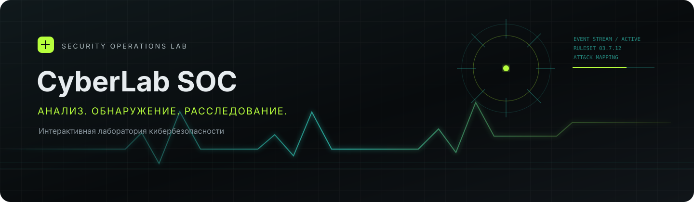

<div align="center">
  
</div>

<h1 align="center">CyberLab SOC Platform</h1>

<p align="center">
  Интерактивная лаборатория для анализа событий, обнаружения угроз и расследования инцидентов.
</p>

<p align="center">
  <a href="https://leakquicked.github.io/cyberlab-soc-platform/">Открыть лабораторию</a>
  &nbsp;·&nbsp;
  <a href="https://github.com/leakquicked/cyberlab-soc-platform">Исходный код</a>
</p>

---

## Обзор

CyberLab SOC Platform — самостоятельное браузерное приложение в эстетике аналитического SOC. Оно помогает изучать путь от сырых журналов до контекста инцидента: нормализовать события, находить учебные индикаторы, сопоставлять наблюдения с MITRE ATT&CK и фиксировать ход расследования.

Приложение работает без сборки, сервера и внешних сервисов. Импортированные журналы обрабатываются в браузере и не отправляются по сети.

## Возможности

- **Рабочее место SOC:** сводные показатели, динамика событий и свежие сигналы.
- **Очередь инцидентов:** поиск, фильтрация по приоритету и статусу, карточки с историей расследования.
- **Анализ журналов:** импорт JSON, JSON Lines, CSV, LOG и TXT; разбор событий и демонстрационные правила обнаружения.
- **MITRE ATT&CK:** учебное сопоставление наблюдений с тактиками и техниками.
- **Рабочий процесс аналитика:** создание учебных расследований, смена статусов и локальное сохранение.
- **Активы и журнал событий:** дополнительные представления для практики и ориентирования в телеметрии.
- **Экспорт:** выгрузка очереди расследований в CSV с поддержкой кириллицы.
- **Адаптивный интерфейс:** широкие и узкие экраны, клавиатурная навигация и настройки отображения.

## Быстрый запуск

Откройте `index.html` в современном браузере. Для локального HTTP-сервера выполните из корня проекта:

```bash
python -m http.server 8000
```

Затем перейдите на <http://127.0.0.1:8000>. В разделе анализа журналов нажмите **«Загрузить пример»**, чтобы увидеть работу правил на безопасных синтетических данных.

## Разбор журналов

Поддерживаются JSON-объект, массив JSON-объектов, JSON Lines, CSV и обычный текст. Приложение распознаёт распространённые варианты полей:

| Поле | Примеры ключей |
| --- | --- |
| Время | `timestamp`, `time`, `@timestamp`, `datetime`, `date` |
| Событие | `event`, `event_type`, `action`, `type`, `message` |
| Пользователь | `user`, `username`, `account`, `principal` |
| Источник | `source_ip`, `src_ip`, `ip`, `client_ip` |
| Узел | `host`, `hostname`, `computer`, `device` |
| Результат | `result`, `status`, `outcome` |

Пример записи:

```json
{
  "timestamp": "2025-04-18T09:41:52Z",
  "event": "login_failed",
  "source_ip": "10.24.8.19",
  "user": "svc_backup",
  "host": "SRV-AD-01",
  "result": "failure"
}
```

Демонстрационное правило подбора учётных данных срабатывает на серии отказов от одного источника. Другие примеры охватывают подозрительные параметры PowerShell и изменение привилегий. Это учебные правила, а не замена SIEM, EDR или проверенных средств обнаружения.

## Конфиденциальность и границы лаборатории

- Используйте синтетические журналы или данные, на анализ которых у вас есть разрешение.
- Не загружайте пароли, токены, секреты и персональные данные.
- Размер файла ограничен 2 МБ, объём анализа — 5 000 записей.
- Импортированные данные обрабатываются в браузере. Приложение их не загружает и не сохраняет.
- Созданные и изменённые инциденты сохраняются в `localStorage` текущего браузера.
- Данные панели и активы учебные; сенсоры, SIEM, EDR и серверные интеграции не подключены.
- Сопоставления MITRE ATT&CK помогают в обучении. Проверяйте выводы по первичным событиям.

## Проверка проекта

Проверки не требуют сторонних зависимостей:

```bash
node --check app.js
python scripts/smoke_check.py
```

Для ручной проверки загрузите пример журнала, примените фильтры очереди, откройте инцидент, измените его статус, создайте новое расследование и выгрузите CSV.

## Структура

```text
.
├── .github/workflows/pages.yml  # публикация на GitHub Pages
├── assets/
│   └── cyberlab-banner.svg      # баннер проекта
├── scripts/
│   └── smoke_check.py           # структурная проверка
├── app.js                       # логика приложения и учебные данные
├── favicon.svg                  # знак проекта
├── index.html                   # разметка интерфейса
├── styles.css                   # тема и адаптивные стили
└── README.md                    # документация
```

## Лицензия

Условия использования приведены в файле [LICENSE](LICENSE).
